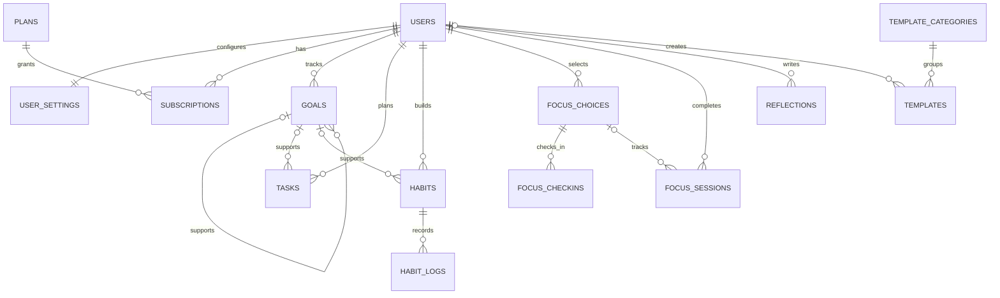

# Chunked

[**Open the live demo →**](https://asmaa-aljazzar.github.io/Chunked/)

Chunked is a calm daily-planning and personal-growth app. It helps people organize a day into manageable chunks, focus on one thing at a time, and keep goals and habits in view.

This repository currently contains a responsive frontend prototype built with HTML, CSS, and vanilla JavaScript. Pages use sample data and browser storage; the PHP backend and live database connection have not been implemented yet.

## Project links

- **Figma product design:** [Complete Chunked Product Design](https://www.figma.com/make/xeK6qXd9XsPCiseZCgg2zI/Complete-Chunked-Product-Design?fullscreen=1&t=iJrxCoTWeAVJrH9j-1&code-node-id=0-6)
- **MVP database diagram (PDF):** [View or download the ER diagram](database/Chunked-mvp.pdf)
- **MVP database diagram source:** [DBML source](database/chunked_mvp.dbml)

The PDF is included in the repository under `database/`. The DBML source can be imported into [dbdiagram.io](https://dbdiagram.io) if you want to edit or export the diagram.

## Features in the frontend prototype

- Public landing page with product overview, themes, and plan information.
- User-facing pages for Dashboard, DAY, the current chunk, GROW, goals, focus, Insights, reflections, templates, profile, and settings.
- Admin workspace with sample user and plan metrics, template management, categories, subscriptions, transactions, announcements, AI usage aggregates, reports, audit examples, and settings.
- Responsive layouts, theme choices, shared navigation components, and small interface animations.
- Demo interactions that save selected changes in the current browser using `localStorage`.

All names, account records, activity, payments, and metrics shown in the prototype are fictional. Demo accounts in the SQL seed use `.example.test` email addresses and invalid password placeholders; they cannot sign in.

## Run locally

There is no package manager or build step at this stage. Because the pages use JavaScript modules, run the project through a local web server instead of opening the HTML files directly with `file://`.

### VS Code Live Server

1. Open this project folder in VS Code.
2. Install the **Live Server** extension if it is not already installed.
3. Right-click `index.html` and choose **Open with Live Server**.
4. Visit the local URL shown by the extension, usually `http://127.0.0.1:5500/`.

The public landing page is `index.html`. The Admin workspace is `admin/dashboard.html`; user pages are in `user/`.

## Project structure

```text
Chunked/
├── index.html                 # Public landing page
├── admin/
│   ├── dashboard.html         # Admin workspace and its section views
│   ├── css/admin.css          # Admin-specific styles
│   └── js/admin.js            # Admin navigation and demo template CRUD
├── user/                      # User-facing HTML pages
├── css/
│   ├── tokens.css             # Theme and design tokens
│   ├── base.css               # Base styles and typography
│   ├── layout.css             # Shared app layout
│   ├── components.css         # Shared controls and components
│   ├── animations.css         # Shared animations
│   └── pages/                 # Page-specific styles
├── js/
│   ├── app.js                 # Shared app initialization
│   ├── components/            # Shared sidebar, topbar, dropdown
│   ├── pages/                 # Page-specific interactions
│   └── utils/                 # Theme, language, profile, and date helpers
└── database/
    ├── chunked_mvp_schema.sql # 15-table MVP schema and fictional demo data
    ├── chunked_mvp.dbml       # Diagram source for dbdiagram.io
    ├── chunked_schema.sql     # Broader future schema reference
    └── admin_schema.sql       # Earlier Admin-only schema; not the full-system import
```

## Database setup with phpMyAdmin

The recommended first database is [`database/chunked_mvp_schema.sql`](database/chunked_mvp_schema.sql). It has **15 tables** for the first backend milestone: accounts/settings, plans/subscriptions, DAY tasks, goals, habits, focus, reflections, and the printable template catalog used by Admin. It creates a separate `chunked_mvp` database, targets XAMPP MariaDB 10.4 and MySQL 8, uses InnoDB and `utf8mb4`, includes fictional sample records, and does not drop existing databases or tables.

For a visual ER diagram, open [`database/chunked_mvp.dbml`](database/chunked_mvp.dbml), copy its contents into [dbdiagram.io](https://dbdiagram.io), and use the site's share option to get a diagram URL. Add the resulting link to the **MVP database diagram** line in Project links above. The DBML reflects the same 15 MVP tables as the SQL file.

[`database/chunked_schema.sql`](database/chunked_schema.sql) is the broader future schema reference based on the supplied DBML. Do not import both files into the same database. `database/admin_schema.sql` is the older Admin-only foundation and is not the recommended starting point.

### Import using the SQL tab

1. Start your local MySQL or MariaDB server (for example, through XAMPP).
2. Open phpMyAdmin.
3. Select the **SQL** tab from the server home page, or from the database if you already created one.
4. Open `database/chunked_mvp_schema.sql`, copy its full contents, and paste them into the SQL box. It creates the separate `chunked_mvp` database.
5. Click **Go** and wait for phpMyAdmin to report the statements completed.
6. Refresh the left database list and open `chunked` to see its tables.

If you want a different database name, change both `chunked_mvp` occurrences before running the script. If your database user cannot create databases, create/select an empty database in phpMyAdmin first, remove the `CREATE DATABASE` and `USE` statements, then execute the rest of the file while that database is selected. Do not import the MVP schema over an existing database. Back up any data you need first.

The demo seed is deliberately small. It does not reproduce the large numbers shown in some frontend metric cards. Those UI numbers are illustrative until the backend reads actual database counts.

## Database relationships

GitHub renders the MVP's high-level relationships below. The SQL file contains all 15 tables and their foreign keys:



- **Included now:** user accounts and settings, theme choices, DAY tasks, goals, habits and daily logs, focus choices/check-ins/sessions, reflections, plans/subscriptions, and Admin-managed printable template categories and PDFs.
- **Deferred:** milestones, detailed schedule history, template download tracking and purchases, payment transactions, announcements/notifications, AI conversations and reporting, and audit history. Add these in later migrations when those features are implemented.
- **Printable templates:** PDFs should stay in private server storage and be served through authorized PHP endpoints; `file_path` is not a public download URL.
- **Demo data:** seeded accounts and activity are fictional. Password markers are invalid and cannot authenticate. Create real accounts with PHP `password_hash()` when authentication is implemented.

The SQL defines the data model; it does not connect the current browser prototype to MySQL. The UI still uses browser `localStorage` for demo interactions. The PHP backend must validate request dates in the user's timezone, including the rule that new records cannot be created for past dates.

## Adding the README and SQL file to GitHub

Both files should be committed to the repository so anyone opening the project can find the setup instructions and schema.

### If you use Git from a terminal

Run these commands from the project folder:

```powershell
git add README.md database/chunked_mvp_schema.sql
git commit -m "docs: add Chunked MVP database schema"
git push
```

If Git asks you to set an upstream for the current branch, follow the command Git prints. Once pushed, GitHub displays `README.md` on the repository front page, and the MVP SQL file is available under `database/chunked_mvp_schema.sql`.

### If you use the GitHub website

1. Open the repository on GitHub.
2. Choose **Add file → Upload files**.
3. Upload `README.md` at the repository root.
4. Upload `chunked_mvp_schema.sql` inside a `database` folder (create the folder by entering `database/chunked_mvp_schema.sql` as the filename if needed).
5. Commit the changes to your branch.

If the project is already connected to this local Git repository, using Git to commit and push is usually easier because it preserves the folder structure and any existing work.

### Keep credentials out of GitHub

The included SQL contains fictional data only. Do not commit real passwords, generated password hashes for personal accounts, database credentials, API keys, payment secrets, or production exports. Later, keep local secrets in an untracked environment file such as `.env`, and provide a sanitized `.env.example` with placeholder values instead.

## Current limitations and next backend step

- This is a frontend-only prototype; the login and signup pages are not connected to server authentication.
- Admin template edits and the current Admin demo category/announcement additions are stored in this browser, not MySQL.
- The MVP SQL data model is in place, but the PHP backend and database connection are not implemented.
- The next backend step is to build PHP endpoints using prepared statements, add session-based authentication and server-side role checks, then connect user and Admin pages to those endpoints.
